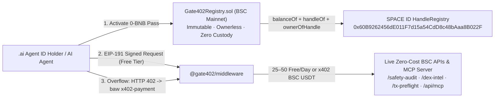

# Gate402

**Sybil-Proof `.ai` Free-Tier & Binance `x402` v2 API Gateway + BSC Guard Pass on BNB Smart Chain**

Built for the **Binance Wallet × BNB Chain Agent ID Hackathon** (Nov 18 – Dec 9, 2026).

### Live BSC Mainnet Deployment (Verified Open-Source)
- **Live Web App & API Gateway:** [https://web-nu-nine-yyzt7gth6g.vercel.app](https://web-nu-nine-yyzt7gth6g.vercel.app)
- **Streamable HTTP MCP Endpoint:** `https://web-nu-nine-yyzt7gth6g.vercel.app/api/mcp`
- **Gate402Registry (Chain 56):** [`0x08441938440B097ABd849FDB0F6CFe700AB6e994`](https://bscscan.com/address/0x08441938440B097ABd849FDB0F6CFe700AB6e994#code) (BscScan & Sourcify Verified · Immutable · Zero Owner)
- **Bound Agent ID HandleRegistry:** [`0x60B9262456dE011F7d15a54CdD8c48bAaa8B022F`](https://bscscan.com/address/0x60B9262456dE011F7d15a54CdD8c48bAaa8B022F)

> **Core Thesis:** Remove Binance's soulbound, 1-per-KYC-human Agent ID (`name.ai`), and bot farms instantly drain any credit-card-free AI/Web3 API free tier. Gate402 makes Agent ID mathematically load-bearing by binding daily free API quotas to verified `.ai` handles on BNB Smart Chain — and seamlessly transitioning overflow traffic to **Binance `x402` v2** BSC USDT/USDC micropayments.

---

## Architecture



---

## What Ships Inside This Monorepo

| Package | Description |
| :--- | :--- |
| [`packages/contracts`](packages/contracts) | Immutable, ownerless `Gate402Registry.sol` (Solidity `0.8.28`) with atomic 3-read `HandleRegistry` checks, Foundry unit + fuzz tests, and **live BSC Mainnet fork tests**. |
| [`packages/middleware`](packages/middleware) | Drop-in TypeScript SDK (`@gate402/middleware`) enforcing stateless EIP-191 `.ai` Pass verification, Sybil-proof UTC daily quotas, and RFC-compliant Binance `x402Version: 2` `PAYMENT-REQUIRED` / `PAYMENT-SIGNATURE` handling. |
| [`apps/web`](apps/web) | Next.js 15 web app featuring the **1-click Free `.ai` Guard Pass**, live **BSC Contract Safety & DEX Scanner**, **Developers & x402 Playground**, **On-Chain Audit Directory**, and Streamable HTTP **MCP Server (`/api/mcp`)**. |
| [`skill/gate402/SKILL.md`](skill/gate402/SKILL.md) | Ready-to-use skill for **Binance Agentic Wallet (`baw`)** strictly following two-step `preview` → explicit user confirmation → `execute`/`sign`. |
| [`docs/THREAT_MODEL.md`](docs/THREAT_MODEL.md) | Full security analysis, **Owner Permission Disclosure**, and compliance matrix for all 10 Hackathon Safety Red Lines. |
| [`docs/LAUNCH_AND_SUBMISSION_KIT.md`](docs/LAUNCH_AND_SUBMISSION_KIT.md) | Step-by-step BSC Mainnet deployment, Vercel hosting, 90s demo video script, and organic distribution kit. |

---

## Owner & Admin Permission Disclosure

`Gate402Registry.sol` is **100% ownerless, immutable, and non-custodial**:
- No `owner()`, no admin keys, no upgrade proxy, no pause/freeze switch, no token minting, and no ability to hold or withdraw BNB or ERC-20 tokens.
- `recordAuditDigest()` and `/api/v1/bsc/safety-audit` enforce smart-contract-only targets (`code.length > 0`), blocking personal EOA wallet lookups by design.

---

## Local Quickstart & Verification

```bash
# 1. Install workspace dependencies
pnpm install

# 2. Run Solidity unit + fuzz tests
pnpm test:contracts

# 3. Run live BSC Mainnet Fork tests against real HandleRegistry (0x60B9...022F)
pnpm test:contracts:fork

# 4. Build & test @gate402/middleware + Web APIs / MCP server
pnpm build
pnpm test:middleware
pnpm test:web

# 5. Start local web app + APIs + MCP server
pnpm dev
```

### Deploy to BSC Mainnet
```bash
cp .env.example .env
# Fill DEPLOYER_PRIVATE_KEY (fresh wallet with ~$3 BNB) & BSCSCAN_API_KEY
pnpm deploy:bsc
```

---

## License

MIT — Independent open-source project built for the BNB Chain ecosystem; not affiliated with or endorsed by Binance.
